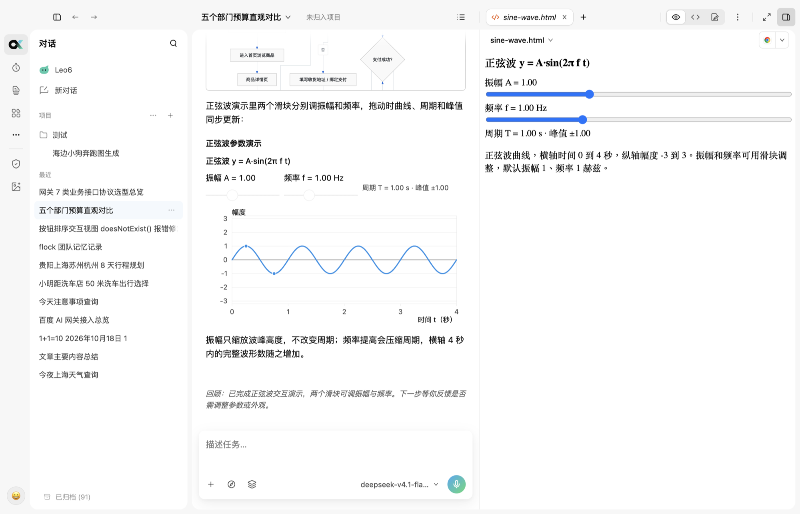
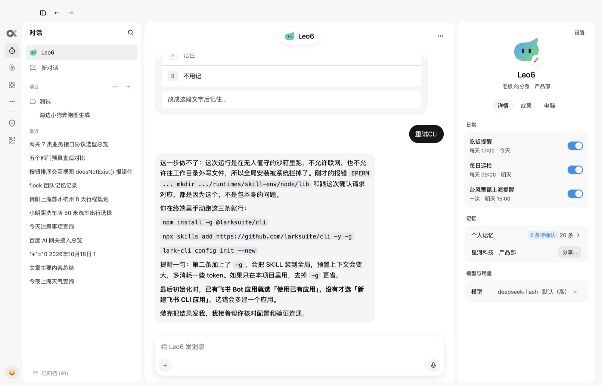
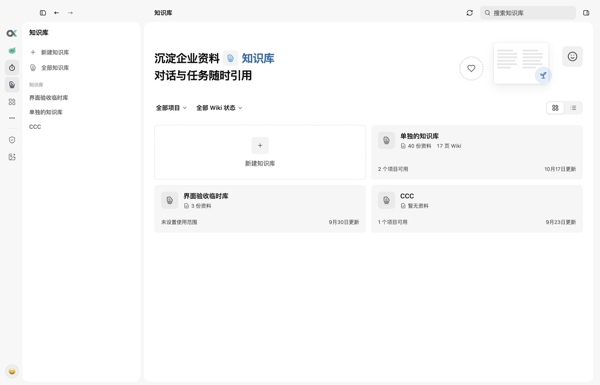
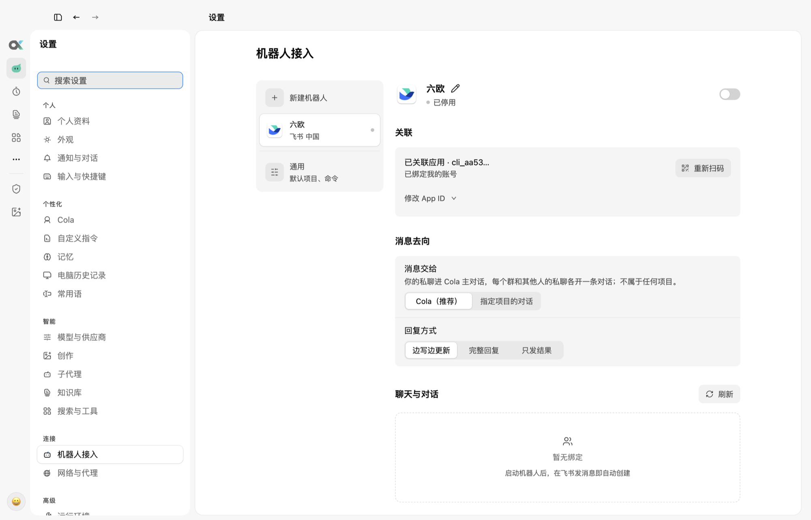

  

<h1 align="center">Cortex</h1>

  <strong>Not just another agent harness.</strong>

  A local-first AI workspace where agents work across your files, knowledge, apps, and chats — with you in control.

  
  
  

  English · <a href="#简体中文">简体中文</a>

  <a href="#download">Download</a>
  ·
  <a href="#features">Features</a>
  ·
  <a href="#screenshots">Screenshots</a>
  ·
  <a href="#updates">Updates</a>
  ·
  <a href="#system-requirements">System requirements</a>
  ·
  <a href="#support">Support</a>

  

## About

Most agent harnesses stop at a loop: a model, some tools, and a prompt. Cortex is the workspace around that loop. It gives the agent a place to work — projects and files, editable documents and presentations, source-backed knowledge, a creative canvas, your desktop, and the chat apps your team already uses — and it keeps you in charge of what the agent may do.

Conversations, projects, and settings are stored locally on your Mac. Model requests go to the providers you configure; connected apps and online tools access their own services within the permissions you grant. Local models and downloaded components can work offline.

## Download

| Platform | Package |
| --- | --- |
| macOS 13 or later, Apple silicon | [Latest release (`.dmg`)](https://github.com/createpjf/cortex-releases/releases/latest) |

1. Open the latest release and download `Cortex-<version>-arm64.dmg`.
2. Drag **Cortex** into **Applications**.
3. Open **Cortex** from Applications and follow the setup to connect a model. You can skip model setup and return to it later.

**The current release is Developer ID–signed and notarized by Apple.** Office and creative editors, local speech models, and knowledge-search models download when needed or when you choose to install them. The setup shows which components are optional; the app checks downloaded components against pinned digests.

## Features

- **Cola, your work double.** A personal agent that follows up on work within the scope you allow, reads across your projects and conversations, and comes back when there is progress or a decision to make.
- **Permissions you choose.** Use **Ask for approval**, **Auto-approve**, or **Plan** for each conversation. These modes retain checks for irreversible commands. Optional **Full access**, enabled separately in Settings, relaxes those checks for attended desktop and CLI conversations; it does not carry over to Cola, bots, or unattended runs.
- **Editable work.** Create documents, slide decks, and data dashboards in a conversation, then reopen and edit the same work from the sidebar. Select a passage to ask the agent to revise it; keep versions and export documents to Word, presentations to PowerPoint, and dashboards to HTML.
- **Source-backed enterprise knowledge.** Search your knowledge bases, follow citations to the original documents, and have the sources checked. Cola retrieves knowledge when needed; regular conversations use their selected knowledge scope.
- **Creative canvas.** Built on a design engine: generation nodes are artboards on the canvas, any layer can be a reference, and every version stays inside its node. Produce images and video, and run a selected chain after previewing it.
- **Computer use.** Let an agent operate apps on your Mac, with per-app permission prompts and one conversation in control at a time.
- **Skills and MCP connectors.** Install a dependency once and every conversation can use it. When a connector fails to start, Cortex shows why.
- **Interactive views.** Agents can answer with live charts, sliders, and demos that you can open beside the chat, tweak, and export as a web page.
- **Bots for WeChat, Feishu / Lark, DingTalk, and Telegram.** Send tasks from your phone and get results back in the same chat. Scan a QR code to create a Feishu app, and choose how replies stream back.
- **Automatic model routing and usage.** Route tasks to model groups and review local cost, run, and token statistics by day, group, and model. A menu-bar or tray overview is available while the current conversation uses Auto; it shows usage, not your provider subscription quota.
- **Built for daily work.** A per-conversation terminal, cloud or local voice input with live transcription, subagents, and background tasks.

## Screenshots

  

<em>Interactive views: live demos in the reply and beside the chat</em>

  

<em>Cola: messenger-style chat with routines, memory, and model settings</em>

  

<em>Knowledge base: verified sources your agents can cite</em>

  

<em>Bots: link a chat app, choose where messages go and how replies arrive</em>

## Updates

Cortex uses this repository as its update feed. With automatic updates enabled, the app checks shortly after launch and every four hours. With automatic downloads enabled, it downloads the update in the background and installs it the next time you quit; you can also restart to update, check manually, or change these options in **Settings › Notifications & chats › Software update**.

Changes and known limitations for each version are on the [Releases](https://github.com/createpjf/cortex-releases/releases) page.

## System requirements

- macOS 13 Ventura or later
- Apple silicon (M1 or later)
- An API key for at least one model provider, added in **Settings › Models & providers**

Intel Macs, Windows, and Linux are not supported by these builds yet.

## Support

Found a bug or have a feature request? [Open an issue](https://github.com/createpjf/cortex-releases/issues/new) with your Cortex version (shown under **Settings › Notifications & chats › Software update**), your macOS version, and the steps to reproduce it. Please search [existing issues](https://github.com/createpjf/cortex-releases/issues) first.

## About this repository

This repository hosts Cortex release builds and serves as its update feed. The current macOS release is Developer ID–signed and Apple-notarized. This repository does not contain source code.

© FLock.io. All rights reserved.

---

## 简体中文

  <strong>不只是又一个 Agent 外壳。</strong>

  本地优先的 AI 工作台：Agent 在你的文件、知识库、应用和聊天之间协同工作，而你始终掌控全局。

### 简介

多数 Agent 外壳只做到一个循环：模型、几个工具和一段提示词。Cortex 是围绕这个循环搭起来的工作台：给 Agent 一个干活的地方——项目与文件、可持续编辑的文档与演示、带来源的知识库、创作画布、你的桌面，以及团队已在用的聊天应用——并让你决定它能做什么。

对话、项目和设置保存在你的 Mac 本地。模型请求发往你配置的供应商；连接应用和联网工具会在你授权的范围内访问各自的服务。本地模型和已下载的组件可离线使用。

### 下载

| 平台 | 安装包 |
| --- | --- |
| macOS 13 及以上，Apple 芯片 | [最新版本（`.dmg`）](https://github.com/createpjf/cortex-releases/releases/latest) |

1. 打开最新版本，下载 `Cortex-<版本号>-arm64.dmg`。
2. 把 **Cortex** 拖进 **应用程序**。
3. 从应用程序打开 **Cortex**，按引导连接模型；也可以跳过，稍后在设置里配置。

**当前版本已用 Developer ID 签名，并通过 Apple 公证。** Office 与创作编辑器、本地语音模型、知识检索模型按需下载或由你选择安装。引导会说明哪些组件可选，下载后会核对固定摘要。

### 功能

- **Cola，你的工作分身。** 个人 Agent，在你允许的范围内跟进工作，跨项目和对话查阅资料，有进展或需要你拍板时再来找你。
- **由你选择的权限。** 每个对话可选「按需确认」「自动执行」或「计划」，这些模式保留不可逆命令的确认。可在设置里单独开启「完全放行」，放宽有人值守的桌面与 CLI 对话的检查；它不延续到 Cola、机器人或无人值守运行。
- **可持续编辑的作品。** 在对话里创建文档、演示和数据看板，之后从侧栏打开同一份作品继续修改。选中段落可让 Agent 局部改写，保留版本，并将文档导出为 Word、演示导出为 PowerPoint、看板导出为 HTML。
- **带来源的企业知识库。** 检索知识库、通过引用打开原文，并对来源进行核验。Cola 按需查阅知识，普通对话使用所选知识范围。
- **创作画布。** 以设计引擎为底：生成节点就是画布上的画板，任何图层都能作参考，每个版本都留在节点里。可生成图片和视频，并在预览确认后运行选定的链路。
- **操作电脑。** 让 Agent 操作你 Mac 上的应用，按应用逐个授权，同一时间只有一个对话在操作。
- **技能与 MCP 连接器。** 依赖装一次，所有对话都能用；连接器启动失败时，Cortex 会告诉你原因。
- **交互视图。** Agent 可以用可交互的图表、滑块和演示来回答，能在对话旁打开、调整并导出成网页。
- **微信、飞书 / Lark、钉钉、Telegram 机器人。** 在手机上发任务，结果回到同一个聊天。飞书扫码即可创建应用，回复方式也可以选。
- **自动选择模型与用量统计。** 按任务路由到模型组，在本地按日、模型组与模型查看费用、调用次数和 Token 用量。当前对话使用自动模式时，可从菜单栏或托盘查看概览；这里显示用量，不代表供应商的订阅额度。
- **为日常工作准备。** 每个对话一个终端、支持云端或本地模型的实时语音转写，以及子代理与后台任务。

### 截图

见上方英文部分的截图：交互视图、Cola、知识库、机器人设置。

### 更新

Cortex 使用本仓库作为更新源。开启自动更新后，启动不久及之后每四小时检查一次；开启自动下载后，在后台下载并于下次退出时安装。也可以在「设置 › 通知与对话 › 软件更新」里重启更新、手动检查或调整这些选项。

每个版本的变更和已知限制见 [Releases](https://github.com/createpjf/cortex-releases/releases) 页面。

### 系统要求

- macOS 13 Ventura 及以上
- Apple 芯片（M1 及以后）
- 至少一个模型供应商的 API Key，在「设置 › 模型」里添加

目前这些安装包暂不支持 Intel Mac、Windows 和 Linux。

### 支持

遇到问题或有功能建议？请 [提交 issue](https://github.com/createpjf/cortex-releases/issues/new)，附上 Cortex 版本（在「设置 › 通知与对话 › 软件更新」里查看）、macOS 版本和复现步骤。提交前请先搜索[已有 issue](https://github.com/createpjf/cortex-releases/issues)。

### 关于本仓库

本仓库存放 Cortex 发布版本，并作为更新源。当前 macOS 版本已用 Developer ID 签名并通过 Apple 公证；本仓库不包含源代码。

© FLock.io。保留所有权利。
